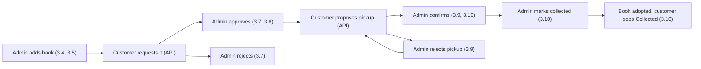

# Adopt-a-Book: Admin User Journeys (E2E)

An admin is a logged-in staff member who runs the back office: the book inventory, adoption applications, pickup appointments and adoption drives. These journeys pick up where the customer journeys stop: an admin is the one who approves requests, confirms pickups and hands books over.

> 🔌 = the step fakes a server response with `page.route()`, because the real data can't produce that situation on demand.

### Which account each journey uses

| Account | Used by | Why |
|---|---|---|
| **A fresh admin**, created through `POST /admin/users` at the start of the journey | every journey (3.1 – 3.14) | Logging out calls `supabase.auth.admin.signOut()`, which signs that user out **everywhere**. If journeys shared one admin, journey 3.1 logging out would sign out every other admin journey running at the same time |
| **The seeded demo admin** (`a3c11c76-…`) | the `admin` fixture only, never a journey | Only an existing admin can create another admin. The fixture logs in as the demo admin in its **own** request context, creates the fresh admin, and never logs the demo admin out |
| **Fresh customers**, registered through `POST /register` | 3.2, 3.6 – 3.12 | Applications, pickups and rsvps need a real customer on the other side. Each customer only touches books the journey created itself |

The demo admin's email and password go in the root `.env` as `e2e_admin_email` and `e2e_admin_password`, next to the demo customer's.

> [!IMPORTANT]
> Admin journeys must **never** decide on, confirm or reject the demo customer's records. The seed gives the demo customer 3 approved requests with pickups awaiting confirmation, and customer journeys 2.6, 2.12 and 2.13 rely on them. Admin journeys only act on records they created themselves (see **Keeping journeys out of each other's way**).

### How each journey logs in

Same idea as the customer journeys:

| Way | How | Used for |
|---|---|---|
| **Through the login form** | open `/login`, type the email and password, click **Login** | Only steps marked **(through the login form)**: 3.1 step 1 |
| **Through the API** | `page.request.post('/login')` before the first `page.goto()` | Everything else |

An `admin` fixture in `e2e/support/admin.js` does this for every journey:

1. **logs in as the demo admin** in a separate `request.newContext()` (so the demo admin's cookies never reach the journey's browser)
2. **creates** a fresh admin with `POST /admin/users` (`e2e-admin-<random>@example.com`)
3. **logs in** as the fresh admin with `POST /login` through `page.request`
4. **hands the journey** `{ id, name, email, password, tag }`
5. **cleans up** after the journey: deletes the books and drives it created that can still be deleted, then deletes the fresh admin with `DELETE /admin/users/:id` (as the demo admin)

```js
test('reviewing adoption applications', async ({ page, admin }) => {
  await page.goto('/admin/applications') // already logged in as a fresh admin
})
```

The same two rules from the customer journeys apply:

- **Send `Origin: <clienturl>` on every API call**, or the server rejects it with "request origin is not allowed".
- **Log in before the first `page.goto()`**, or the app decides "guest" and sends the journey to Login.

And one new one:

- **Customers act through their own request context.** `page.request` shares cookies with the admin's browser, so logging a customer in on it would replace the admin's session. Customer setup (`POST /applications`, `POST /appointments`, rsvps) uses `playwright.request.newContext()` per customer. Steps that check what a customer or guest **sees** open a second `browser.newContext()`.

### Keeping journeys out of each other's way

Admin pages list **every** record in the database, and journeys run in parallel against the same test database. So:

- Every record a journey creates carries the journey's **tag** (`e2e-<random>`) in its title, e.g. `Tidy Shelves e2e-k3x9q2`.
- Before checking a list, the journey types its tag into the page's search box. The server filters by it (`?search=`), so only the journey's own rows show and the counts belong to the journey.
- Counts that can't be filtered by tag (the dashboard cards) are read from the server's response and checked against the UI, never hardcoded. The seed's own pending pickups are always in them.

`e2e/support/admin.js` also has the setup helpers the journeys share:

| Helper | Creates (through the API) |
|---|---|
| `createBook(admin, changes)` | one available, tagged book at a real MRT station |
| `createDrive(admin, changes)` | one open, tagged drive (default: 10 days from today, capacity 30) |
| `newCustomer()` | a fresh, logged-in customer in its own request context |
| `seedAdoption(admin, stage)` | a tagged book plus a fresh customer, taken as far as `stage`: `'requested'` → `'approved'` → `'pickup proposed'` (future date) / `'pickup today'` → `'pickup confirmed'` |

---

### 🔑 3.1 "Back office": logging in and finding my way around
**File:** `e2e/admin/01-log-in-and-look-around.spec.js`
**Goal:** an admin logs in and checks what they can and can't reach.
**Pages:** Login → Book inventory → every admin page

| # | The admin… | We check that… |
|---|---|---|
| 1 | logs in with their email and password **(through the login form)** | the button says **"Logging in…"**, then **"login successful"** appears and they land on **Book Inventory** (`/admin/books`) |
| 2 | looks at the navbar | it shows **Home**, **Book Inventory**, **Adoption Applications**, **Appointments**, **Drives** and **Logout**, and none of the guest or customer links |
| 3 | clicks each navbar link in turn | each page opens with its own heading (**Dashboard**, **Book Inventory**, **Adoption applications**, **Appointments**, **Drives**) and active link state |
| 4 | clicks the **Adopt a Book** logo | they're taken to the **Dashboard** (`/admin`) |
| 5 | reloads the page | they're still logged in, with the same navbar |
| 6 | types a guest address (`/`, `/drives`, `/login`, `/register`) | each one sends them to `/admin/books` instead |
| 7 | types a customer address (`/customer`, `/customer/books`, `/customer/adoption`) | each one sends them to `/admin/books`, not to the customer page |
| 8 | clicks **Logout** | they land on **Login**, and the navbar is back to the guest links |
| 9 | presses the browser **Back** button | they're sent to **Login**, not back into an admin page |

---

### 🧭 3.2 "What needs me today?": reading the dashboard
**File:** `e2e/admin/02-read-the-dashboard.spec.js`
**Goal:** an admin starts the day on the dashboard and jumps straight to the work waiting for them.
**Pages:** Dashboard → Adoption applications → Appointments → Drives
**Setup:** `seedAdoption()` creates one `'requested'` and one `'pickup proposed'` adoption, so both queues have at least one record.

| # | The admin… | We check that… |
|---|---|---|
| 1 | opens **Home** | **Dashboard** shows today's date with **"Singapore time"**, loading placeholders appear briefly, then 4 cards: **Requests awaiting review**, **Pickups awaiting confirmation**, **Pickups today** and **Overdue pickups**, each with the count the server sent (`counts.pending`, `total` for `awaiting`, `counts.today`, `total` for `overdue`) |
| 2 | looks at **Needs attention** | 4 tabs (**Overdue**, **Pickup confirmations**, **Adoption requests**, **Upcoming drive**) each carry the same count as their card |
| 3 | clicks across the 4 tabs | each shows the first record in its queue with **"· 1 of N"** and how it's ordered (**Oldest collection date first**, **Earliest proposed time first**, **Oldest request first**, **Earliest event first**); **Upcoming drive** shows the drive's title, venue, date, status and **"x / y registrations"** |
| 4 | opens **Pickup confirmations** and clicks **Review proposal** | **Appointments** opens on the **Awaiting confirmation** tab with that record's **Appointment details** already open |
| 5 | goes back and clicks the **Requests awaiting review** card | **Adoption applications** opens on the **Pending** tab |
| 6 | goes back and clicks the **Pickups today** card | **Appointments** opens on the **Today's pickup** tab |
| 7 | goes back and checks **Today's pickups** | it lists up to 5 of today's confirmed pickups (book, status, **Customer:**, **Time/Location:**) or says **"No pickups today."**; **View all** opens the **Today's pickup** tab |
| 8 | 🔌 has empty queues | each tab says its empty message (**"No overdue pickups."**, **"No pickups awaiting confirmation."**, **"No pending adoption requests."**, **"No upcoming drives."**) and the cards show `0` |
| 9 | 🔌 opens the dashboard while `/admin/drives` is down (503) | an error toast with **retry** appears, the **Upcoming drive** tab shows **"—"** and **"Queue preview unavailable."** (not a false `0`), the other cards are normal, and **retry** fills it in once the server is back |

---

### 📚 3.3 "What's on the shelves?": browsing the inventory
**File:** `e2e/admin/03-browse-the-inventory.spec.js`
**Goal:** an admin finds a particular copy and checks its details.
**Pages:** Book inventory
**Setup:** `createBook()` × 2 (one with no ISBN and no description), plus one `'approved'` adoption so a tagged **reserved** book exists.

| # | The admin… | We check that… |
|---|---|---|
| 1 | opens **Book Inventory** | **"Manage book records and track their availability."**, tabs **All books**, **Available**, **Reserved**, **Adopted** with the server's counts, up to **15 rows**, and **"1–15 of N books"** with **Page 1 of M** |
| 2 | goes to the next page | a different set of rows shows with **"16–30 of N books"**; then searching anything takes them back to **Page 1** |
| 3 | searches for their tag | after a short pause only their 3 books show, and the tab counts drop to match |
| 4 | searches by an author's name, then by an ISBN | the rows still match what `/admin/books` returned for each search |
| 5 | picks a genre from **All genres** | only books with that subject stay |
| 6 | opens the **Reserved** tab | only the reserved book shows, with a **reserved** badge, and rows have **no checkboxes** (only **All books** and **Available** allow selecting) |
| 7 | searches for something that doesn't exist | **"No books in this view"** and **"Try another Status Tab, Genre, Search term"** |
| 8 | clears the search and clicks a book | **Book details** shows the cover, title, author, status and **Title**, **Authors**, **Condition**, **Collection area**, **Subjects**, **ISBN**, **First publication**, **Open Library ID**, **Source** and **Updated at** |
| 9 | opens the book with no ISBN and no description | empty fields say **"Not provided"** and the description says **"No description recorded."** |
| 10 | opens the reserved book, then presses **Esc** | **Edit** is disabled for a reserved copy, and **Esc** closes the window |

---

### 🔎 3.4 "New donations arrived": adding books from Open Library
**File:** `e2e/admin/04-add-books-from-open-library.spec.js`
**Goal:** an admin adds a pile of donated books by looking them up instead of typing them in.
**Pages:** Book inventory
**Note:** `/admin/open-library` is always 🔌 faked. It calls the real Open Library website, which is slow and changes its results.

| # | The admin… | We check that… |
|---|---|---|
| 1 | clicks **Add Book** | **Add book** opens on **Find on Open Library**, with **Enter manually** and a **Search** button that stays disabled until they type |
| 2 | 🔌 searches for a title | the button says **"Searching…"**, **"Searching Open Library…"** shows, then **"3 results · 0 selected"** and a table with each book's cover, title, author, ISBN and first publication (or **"Not provided"**) |
| 3 | clicks two rows | both are ticked, **"3 results · 2 selected"** shows and **Next** is enabled |
| 4 | clicks **Next** | **Choose collection locations** shows **"2 books to add"**, an MRT station dropdown and **Remove** for each book, and **Add 2 books** |
| 5 | clicks **Add 2 books** without choosing stations | **"Choose an MRT station for each highlighted book."** appears, both dropdowns are marked invalid and the first one is focused |
| 6 | chooses a station for the first book, then clicks **Remove** on the second | the button becomes **Add 1 book** |
| 7 | clicks **Back to results**, ticks the second book again and clicks **Next** | the first book still has its station; the second needs one |
| 8 | chooses the second station and clicks **Add 2 books** | one `POST /admin/books` is sent per book with `source: 'open_library'`, **"2 books added"** appears, the window closes, and searching for them shows both as **available** |
| 9 | 🔌 adds 2 books when the second `POST /admin/books` fails | **"1 book added"** and **"1 book could not be added"** (with `<title>: <error>`) appear, the window **stays open** with only the failed book left to retry, and retrying adds it |
| 10 | 🔌 searches for something with no matches | **"0 results · 0 selected"** and **"Try another title, author or ISBN, or enter the book manually."** |
| 11 | 🔌 searches while Open Library is down (502) | the error toast **"open library search unavailable"** appears and they can search again |

---

### ✍️ 3.5 "Not on Open Library": adding a book by hand
**File:** `e2e/admin/05-add-a-book-manually.spec.js`
**Goal:** an admin types in a book Open Library doesn't know, with a photo of its cover.
**Pages:** Book inventory
**Setup:** small JPG and PNG files, a GIF and a 6 MB PNG in `e2e/support/files/`.

| # | The admin… | We check that… |
|---|---|---|
| 1 | clicks **Add Book**, then **Enter manually** | the form shows **Title \***, **Authors (comma separated)**, **Cover photo**, **Condition**, **Collection area (MRT station) \***, **Description** and a closed **ISBN and other metadata** section, with **Cancel**, **Add and continue** and **Add book** |
| 2 | clicks **Add book** with nothing filled in | **"Please check the highlighted fields. Title and collection area are required; enter only one subject."** appears and **Title** is focused and marked invalid |
| 3 | types only spaces as the title, and two subjects separated by a comma | the title is still invalid, and **ISBN and other metadata** opens by itself with **Subject** marked invalid |
| 4 | chooses a GIF, then a 6 MB PNG as the cover | **"Choose a JPG, PNG or WebP image."**, then **"This photo exceeds 5 MB. Choose a smaller file."** show under the field (`role="alert"`) and as toasts, and no preview appears |
| 5 | chooses a small PNG | a preview, the file name and **"Photo will be saved when you save the book."** show, the button says **Change photo**, and **Cover URL** is disabled |
| 6 | fills in the rest and clicks **Add and continue** | `POST /admin/books/cover` is sent first, then `POST /admin/books` with that `coverurl`; **"you have created book … successfully!"** appears and the form **empties but stays open** |
| 7 | fills in a second book (no photo) and clicks **Add book** | the window closes, and searching for the tag shows both books, the first with its cover |
| 8 | 🔌 adds a book with a photo when `POST /admin/books` fails | the error toast appears, `DELETE /admin/books/cover` is sent with the uploaded `coverurl` so no unused photo is left behind, and their typing is kept |
| 9 | types a title, then presses **Esc** | **"Discard your changes?"** asks with **Keep editing** and **Discard**; **Keep editing** returns to the form with the title still there; **Discard** closes it |
| 10 | opens **Add Book** → **Enter manually** again and presses **Esc** without typing | the window closes without asking |

---

### 🛠️ 3.6 "That's the wrong condition": editing and deleting books
**File:** `e2e/admin/06-edit-and-delete-books.spec.js`
**Goal:** an admin fixes a book's details and removes copies that were added by mistake.
**Pages:** Book inventory
**Setup:** `createBook()` × 3, plus one `'approved'` adoption (a reserved book), all tagged.

| # | The admin… | We check that… |
|---|---|---|
| 1 | searches for their tag and ticks one available book | **"1 selected"** shows with **Edit** and **Delete** |
| 2 | clicks **Edit** | **Edit book** opens filled in with the book's details and its **available** badge, with **Save changes** |
| 3 | changes the title and condition and clicks **Save changes** | the button says **"Saving…"**, **"you have updated book … successfully!"** appears, the window closes and the row shows the new title |
| 4 | opens the book's details | **Condition** and **Updated at** show the new values; **Edit** inside the window opens the same form |
| 5 | ticks a second book | **"2 selected"**, and **Edit** is disabled (it only works on one book) |
| 6 | also ticks the reserved book | **"Only available books can be deleted."** shows, and **Delete** and **Edit** are disabled |
| 7 | unticks the reserved book, clicks **Delete**, then **Cancel** | **"Delete books?"** lists both titles and warns that related applications, appointments and watchlist entries are deleted too; **Cancel** sends no `DELETE` |
| 8 | clicks **Delete** again and confirms | the button says **"Deleting…"**, **"2 deleted"** appears with both titles numbered, the rows disappear and the **All books** count drops by 2 |
| 9 | 🔌 deletes a book when `DELETE /admin/books` fails | the error toast appears and the row stays |

---

### 📝 3.7 "Who wants this book?": reviewing adoption applications
**File:** `e2e/admin/07-review-applications.spec.js`
**Goal:** an admin works through new requests, approving one and turning one down.
**Pages:** Adoption applications → Book inventory
**Setup:** `seedAdoption(admin, 'requested')` × 2: two tagged books, each requested by a different fresh customer.

| # | The admin… | We check that… |
|---|---|---|
| 1 | opens **Adoption Applications** | the **Pending** tab and **Oldest first** are selected, with tabs **All applications**, **Pending**, **Approved**, **Rejected** and **Cancelled** and the server's counts |
| 2 | searches for their tag | only their 2 requests show, each with the applicant's name and email, the requested copy, the submitted date and a **pending** badge |
| 3 | switches to **Newest first** | the two rows swap places |
| 4 | clicks the first request | **Application details** shows the book, a **pending** badge, **Applicant**, **Email**, **Submitted**, **Collection area**, **Reason** (**"No reason stated."**) and **Reject** and **Approve** |
| 5 | clicks **Approve**, then confirms | **"Approve application?"** explains the copy becomes reserved and competing requests are rejected, and names `<applicant> — <title>`; confirming shows **"1 application approved"**, the row leaves **Pending**, and the **Approved** tab lists it |
| 6 | opens **Book Inventory** and searches for that book | it's now **reserved**, and **Edit** is disabled |
| 7 | goes back, ticks the second request and clicks **Reject** | **"Reject application?"** asks (with a red **Reject** button); confirming shows **"1 application rejected"** and the **Rejected** tab lists it |
| 8 | opens the rejected request | **Application details** has **no** Approve or Reject buttons |
| 9 | searches for something that doesn't exist | **"No matching applications"** and **"Try another search term or status."** |

---

### ⚖️ 3.8 "Two readers, one copy": competing requests and bulk decisions
**File:** `e2e/admin/08-competing-requests-and-bulk-decisions.spec.js`
**Goal:** an admin decides several requests at once, including two readers asking for the same copy.
**Pages:** Adoption applications
**Setup:** tagged book **A** requested by fresh customers 1 and 2; tagged book **B** requested by customer 3.

| # | The admin… | We check that… |
|---|---|---|
| 1 | searches for their tag and ticks both requests for book A | **"Choose one reader per copy to approve requests."** shows; **Approve** is disabled and **Reject** is not |
| 2 | unticks customer 2 and ticks customer 3's request (book B) | **Approve** is enabled |
| 3 | clicks **Approve** and confirms | **"Approve applications?"** lists both readers, then **"2 applications approved"** appears |
| 4 | opens the **Rejected** tab | customer 2's request for book A was rejected automatically |
| 5 | opens **All applications** and ticks an approved request | **"Only pending applications can be approved or rejected."** shows and both buttons are disabled |
| 6 | opens the **Approved** tab | rows have **no checkboxes** (only **All applications** and **Pending** allow selecting) |
| 7 | 🔌 approves 2 requests when the second `PATCH` fails (409 **"only pending applications can be decided"**) | **"1 application approved"** and **"1 decision failed"** (with `<applicant>: only pending applications can be decided`) both appear, and the list reloads from the server |
| 8 | 🔌 opens a pending request whose copy is no longer available | **"Decisions require an available copy."** shows and **Approve** and **Reject** are disabled |

---

### 📅 3.9 "Does Thursday work?": confirming and rejecting pickups
**File:** `e2e/admin/09-confirm-and-reject-pickups.spec.js`
**Goal:** an admin goes through pickup times customers have proposed.
**Pages:** Appointments → Book inventory
**Setup:** `seedAdoption(admin, 'pickup proposed')` × 3, with pickups 3, 5 and 7 days from today.

| # | The admin… | We check that… |
|---|---|---|
| 1 | opens **Appointments** | **Awaiting confirmation** is selected, with tabs **Awaiting confirmation**, **Today's pickup**, **Upcoming**, **Overdue** and **History** and the server's counts; there's a **Collection date** picker and no status dropdown |
| 2 | searches for their tag | their 3 pickups show, each with the customer's name and email, the book, **"date · time"** and location, and a **pending** badge |
| 3 | picks the first pickup's date in **Collection date**, then clicks **Clear collection date** | only that pickup shows, then all 3 come back |
| 4 | clicks the first pickup | **Appointment details** shows **Customer**, **Email**, **Collection date**, **Time** and **Location**, **"Confirm after checking the requested date, time, and location."**, and **Reject appointment** and **Confirm appointment** |
| 5 | clicks **Confirm appointment** and confirms | **"Confirm appointment?"** repeats the customer, book, date, time and location; confirming shows **"1 appointment confirmed"**, and the pickup moves to **Upcoming** with a **confirmed** badge |
| 6 | opens the second pickup, clicks **Reject appointment** and confirms | **"Reject appointment?"** says the book stays reserved and the customer can propose another time; then **"1 appointment rejected"**, and **History** filtered to **Rejected** lists it |
| 7 | checks the rejected pickup's book in **Book Inventory** | it's still **reserved** |
| 8 | in **Upcoming**, ticks the confirmed pickup and the third (pending) one | **"Filter by Pending to confirm appointments, or Confirmed to mark them collected."** shows and both buttons are disabled |
| 9 | filters **Upcoming** to **Pending**, ticks the pending pickup and clicks **Confirm appointments** | **"1 appointment confirmed"** |
| 10 | switches between tabs | the status dropdown resets to **All statuses** each time, offers **Pending** / **Confirmed** in **Upcoming** and **Overdue**, **Collected** / **Cancelled** / **Rejected** in **History**, and is hidden in **Awaiting confirmation** and **Today's pickup** |

---

### 🤝 3.10 "Here's your book": collection day
**File:** `e2e/admin/10-hand-over-a-book.spec.js`
**Goal:** a customer turns up today, and the admin follows the pickup through to the book being adopted.
**Pages:** Appointments → Dashboard → Book inventory, plus the customer's **My Adoptions** in a second browser
**Setup:** `seedAdoption(admin, 'pickup today')`: the customer proposes a pickup for **today**.

| # | The admin… | We check that… |
|---|---|---|
| 1 | opens **Appointments** and the **Overdue** tab | today's pickup is here, not in **Awaiting confirmation** (a pickup due today that isn't confirmed yet counts as overdue) |
| 2 | opens the **Dashboard**'s **Overdue** tab | the preview says **"Collection due today and awaiting confirmation."** |
| 3 | goes back to **Appointments** and confirms the pickup | **"1 appointment confirmed"**, and the pickup moves to **Today's pickup** (which has no **Collection date** picker) |
| 4 | opens the **Dashboard** | **Today's pickups** lists it with **Customer:** and **Time/Location:**, and the **Pickups today** card went up by one |
| 5 | clicks it in **Today's pickups** | **Appointments** opens on **Today's pickup** with its details open and **"Mark collected only after the customer has physically received the book."** |
| 6 | clicks **Mark collected** and confirms | **"Mark appointment collected?"** says the copy will become adopted; then **"1 appointment marked collected"**, and **History** lists it as **collected**, with no action buttons in its details |
| 7 | opens **Book Inventory** → **Adopted** and searches for the book | it's **adopted**, with no checkbox and **Edit** disabled in its details |
| 8 | (as the customer, in a second browser) opens **My Adoptions** → **History** | the book is listed as **Collected** |
| 9 | 🔌 opens a pending pickup dated in the past | **"Past appointments cannot be confirmed. The customer needs to reschedule."** shows, **Confirm appointment** is disabled and **Reject appointment** is not |

---

### 🎪 3.11 "Let's run a drive": creating and editing an adoption drive
**File:** `e2e/admin/11-create-and-edit-drives.spec.js`
**Goal:** an admin plans a new drive, checks what books will be there, and tweaks it later.
**Pages:** Drives, plus the guest **Adoption drives** page in a second browser

| # | The admin… | We check that… |
|---|---|---|
| 1 | opens **Drives** | **Upcoming** is selected, with **Upcoming** and **Past** tabs and the server's counts, an **Event date** picker, and a status dropdown with **All statuses**, **Open** and **Closed** |
| 2 | clicks **Create drive** | **Create drive** shows **Drive title \***, **Venue and address \***, **Nearest MRT station \***, **Event date \*** (today), **Maximum capacity \*** (`30`) and **Description** |
| 3 | clicks **Create drive** with no title | **"Please check the highlighted fields. Complete all required fields and check the date and capacity."** appears and **Drive title** is focused and marked invalid |
| 4 | picks a date before today, and a capacity of `0` | both fields are marked invalid and nothing is sent |
| 5 | fills it in properly (10 days from today) and saves | the button says **"Saving…"**, **"adoption drive created successfully"** appears, and searching for the tag shows it with **"0 / 30"** and an **open** badge |
| 6 | (as a guest, in a second browser) opens **Adoption Drives** | the new drive is listed |
| 7 | clicks the drive | **Drive details** shows the title, **open** badge, description, **Event date**, **Location** with **Open in Google Maps ↗** (`target="_blank"`, `rel="noopener noreferrer"`), **Registrations** `0 / 30`, and **Available books** at that station |
| 8 | types a title from that list into **Search by Title or Author...**, then something that doesn't exist | only that book stays, then **"No matching books"** |
| 9 | clicks **Edit** | **Edit drive** opens filled in, with **"0 registered. Capacity cannot be lower than this count."** |
| 10 | changes the title and capacity and clicks **Save changes** | **"adoption drive updated successfully"**, and the row shows the new title and capacity |
| 11 | (a fresh customer rsvps through the API) reopens **Edit** and sets the capacity to `0` | **"1 registered. Capacity cannot be lower than this count."** and the capacity is marked invalid |
| 12 | presses **Esc** with that unsaved change | **"Discard your changes?"**; **Discard** closes the form and the drive keeps its saved capacity |

---

### 🚫 3.12 "Change of plans": closing, cancelling and deleting drives
**File:** `e2e/admin/12-close-cancel-and-delete-drives.spec.js`
**Goal:** an admin stops registrations for a full drive, cancels one, and removes drives that were created by mistake.
**Pages:** Drives, plus the guest **Adoption drives** page in a second browser
**Setup:** `createDrive()` × 4, all tagged and open.

| # | The admin… | We check that… |
|---|---|---|
| 1 | searches for their tag and ticks one drive | **"1 selected"** with **Edit**, **Close registration**, **Cancel drives** and **Delete** |
| 2 | clicks **Close registration** and confirms | **"Close registration?"** says existing registrations remain; then **"1 drive closed"** and a **closed** badge |
| 3 | (as a guest, in a second browser) opens that drive | it says **"registration has closed"** instead of **rsvp** |
| 4 | ticks the closed drive again | **Close registration** is disabled and **Cancel drives** is not |
| 5 | opens a different drive and clicks **Cancel drive**, then confirms | **"Cancel drive?"** says registrations remain for reference; then **"1 drive cancelled"**, and the drive moves to the **Past** tab |
| 6 | opens the **Past** tab and the cancelled drive | rows have no checkboxes, the status dropdown offers **Closed** and **Cancelled**, and **Drive details** has no **Available books** and no action buttons |
| 7 | goes back to **Upcoming**, ticks the 2 remaining open drives and clicks **Delete** | **"Delete drives?"** says the drives and their registrations will be permanently deleted; confirming shows **"2 drives deleted"** and they're gone |
| 8 | filters by an **Event date** with no drives | **"No matching drives"** and **"Try another date, status, search term, or view."** |
| 9 | 🔌 closes 2 drives when the second `PATCH` fails | **"1 drive closed"** and **"1 update failed"** (with `<title>: <error>`) both appear, and the list reloads |

---

### ⚠️ 3.13 "Something's wrong": server problems and an expired session
**File:** `e2e/admin/13-server-errors-and-expired-session.spec.js`
**Goal:** an admin keeps working when things go wrong, and recovers without reloading.
**Pages:** Book inventory → Adoption applications → Appointments → Drives → Login

| # | The admin… | We check that… |
|---|---|---|
| 1 | 🔌 opens **Book Inventory** while `/admin/books` is down (503) | an error toast with **retry** appears, no table or page count shows, and **retry** loads the books once the server is back |
| 2 | 🔌 opens **Adoption Applications**, **Appointments** and **Drives** while their lists are down | each shows the same error toast with **retry**, which loads the list once the server is back |
| 3 | 🔌 clicks a book whose details (`/admin/books/:id`) fail to load | an error toast appears and no window opens; clicking again asks the server again and opens it |
| 4 | 🔌 clicks **Add Book** and **Create drive** while `/locations/stations` is down | an error toast appears and the form doesn't open; it opens once the server is back |
| 5 | 🔌 opens a drive whose **Available books** (`/books`) fail to load | the drive details still show, the book list is hidden, and the toast's **retry** loads it |
| 6 | 🔌 approves a request when `PATCH /admin/applications/:id/status` fails | **"1 decision failed"** appears with the reason, and the request stays **pending** |
| 7 | 🔌 starts deleting a book, leaves the confirmation open, and navigates to another page | the confirmation disappears and no `DELETE` is ever sent |
| 8 | 🔌 their session expires (cookies cleared / server answers 401) and they click to another page | they're sent to **Login** and the navbar shows the guest links |

---

### 📱 3.14 "On my phone": using the back office on a small screen
**File:** `e2e/admin/14-use-on-a-phone.spec.js` *(phone-sized screen: Pixel 5)*
**Goal:** an admin checks requests on their phone while away from a desk.
**Pages:** Book inventory → Adoption applications → Appointments

| # | The admin… | We check that… |
|---|---|---|
| 1 | logs in and taps **☰** | the menu shows all 5 admin links and **Logout**, and pressing **Esc** closes it |
| 2 | taps **Book Inventory** | the menu closes, the table is replaced by one card per book with **Select all visible rows**, **Select record** and **View details** |
| 3 | taps **View details** on a card | **Book details** fits the screen and can be scrolled to **Edit** |
| 4 | opens **☰** → **Adoption Applications**, and taps **Select record** on a tagged request | **"1 selected"** shows with full-width **Approve** and **Reject** buttons, and the confirmation fits the screen |
| 5 | opens **☰** → **Appointments** and scrolls to the bottom | the page count and **Next page** stay stuck to the bottom of the screen |
| 6 | opens **☰** and taps **Logout** | they land on **Login**, and the menu is closed |

---

### Admin summary

All files live in `client/e2e/admin/`. The number at the front matches the journey number.

| # | Journey | File | Pages it crosses | Steps |
|---|---|---|---|---|
| 3.1 | Logging in and finding my way around | `01-log-in-and-look-around.spec.js` | Login → every admin page | 9 |
| 3.2 | Reading the dashboard | `02-read-the-dashboard.spec.js` | Dashboard → Applications → Appointments → Drives | 9 |
| 3.3 | Browsing the inventory | `03-browse-the-inventory.spec.js` | Book inventory | 10 |
| 3.4 | Adding books from Open Library | `04-add-books-from-open-library.spec.js` | Book inventory | 11 |
| 3.5 | Adding a book by hand | `05-add-a-book-manually.spec.js` | Book inventory | 10 |
| 3.6 | Editing and deleting books | `06-edit-and-delete-books.spec.js` | Book inventory | 9 |
| 3.7 | Reviewing adoption applications | `07-review-applications.spec.js` | Applications → Book inventory | 9 |
| 3.8 | Competing requests and bulk decisions | `08-competing-requests-and-bulk-decisions.spec.js` | Applications | 8 |
| 3.9 | Confirming and rejecting pickups | `09-confirm-and-reject-pickups.spec.js` | Appointments → Book inventory | 10 |
| 3.10 | Collection day | `10-hand-over-a-book.spec.js` | Appointments → Dashboard → Book inventory → customer My Adoptions | 9 |
| 3.11 | Creating and editing an adoption drive | `11-create-and-edit-drives.spec.js` | Drives → guest Drives | 12 |
| 3.12 | Closing, cancelling and deleting drives | `12-close-cancel-and-delete-drives.spec.js` | Drives → guest Drives | 9 |
| 3.13 | Server problems and an expired session | `13-server-errors-and-expired-session.spec.js` | Every admin page → Login | 8 |
| 3.14 | Using the back office on a phone | `14-use-on-a-phone.spec.js` | Book inventory → Applications → Appointments | 6 |
| | **Total** | | **14 journeys** | **129** |

### How a book travels through the journeys

Together, 3.4/3.5 → 3.7 → 3.9 → 3.10 cover the whole life of a copy, with the customer's side of each step done through the API:



---

# What the tests need

| What | How |
|---|---|
| An `admin` fixture | `e2e/support/admin.js` creates a fresh admin and logs it in through the API (see **How each journey logs in**) |
| Demo admin login | `e2e_admin_email` and `e2e_admin_password` in the root `.env` |
| Setup helpers | `createBook()`, `createDrive()`, `newCustomer()` and `seedAdoption()` in `e2e/support/admin.js`, reusing `callApi()` and `registerCustomer()` from `customer.js` |
| Test files | small JPG / PNG, a GIF and a 6 MB PNG in `e2e/support/files/` for journey 3.5 |
| A test database | journeys create admins, customers, books, drives, applications and appointments every run, so they must **not** run against the team's shared database (same as the guest and customer journeys) |

---

# Not tested here

| What | Why |
|---|---|
| Managing admin accounts (`/admin/users`) | The server supports it but there's no page for it yet. The fixture uses it only for setup |
| A customer calling `/admin/...` directly (403 **"admin access required"**) | That's a server test, not a journey. Guest journey 1.6 and customer journey 2.1 already check the admin pages redirect them |
| Real Open Library results | `/admin/open-library` is always faked so results don't change under the tests (see 3.4) |
| Overdue pickups and past drives with real data | The database refuses past dates for new pickups and drives, so 3.2, 3.9 and 3.10 fake them |
| Exact colours, fonts and spacing | E2E checks behaviour and content, not design |
| Firefox and Safari | Chrome only for now, same as the guest and customer journeys |

---

# Things we noticed while planning

- **Admins land on Book Inventory after logging in, but the logo goes to the Dashboard.** `homeRoute` in `lib/auth.js` sends admins to `adminBooks`, while `AppNavbar.vue` sends the logo to `adminHome`. Guest and customer addresses also redirect admins to `/admin/books`. Journey 3.1 checks today's behaviour; if the Dashboard becomes the landing page, update steps 1, 6 and 7.
- **Logging out signs the account out everywhere.** `/logout` calls `supabase.auth.admin.signOut(token)`, which ends **all** of that user's sessions by default. That's why every journey uses a fresh admin. It also means a customer journey that logs out the demo customer would break other journeys running at the same time.
- **The checkboxes on Applications and Appointments are labelled with a raw id.** `AdminTable.vue` labels them `Select ${row.title || row.id}`, and those rows have no `title`, so screen readers hear `Select 3f2a…`. Journeys find these checkboxes by their row instead. Drive and book checkboxes are fine.
- **"1 books to add".** `BookImportSelection.vue` always writes `books`; the button below it (**Add 1 book**) gets it right. Journey 3.4 doesn't check the status line for a single book until this is fixed.
- **Cancelling a single drive from the list says "Cancel drives".** The confirmation title is **"Cancel drive?"** but its button is still **Cancel drives**.
- **Past drives can't be deleted from the page.** The **Past** tab turns selecting off, and the details window has no buttons for past drives, so a drive created by mistake can only be deleted while it's upcoming.
- **A pickup due today that isn't confirmed shows under Overdue**, not **Awaiting confirmation** or **Today's pickup**. That's intentional (`matchesView()` in `Appointments.vue`), and journey 3.10 relies on it.
- **Application details always says "No reason stated."** Customers can't give a reason yet, so the server never sends one.
- **The dashboard opens Appointments tabs through navigation state, not the URL.** There's no `/admin/appointments?view=today` link to open directly, so journeys click the dashboard instead of using `page.goto()`.
- **Reserved and adopted books can't be deleted**, so tagged books from 3.3, 3.6, 3.7 – 3.10 pile up in the test database. Running with `e2e_seed=true` resets users and demo activity, but `seed.sql` doesn't remove extra books. The team needs to decide between a cleanup step (for example, `/clear` before `/seed` in `global-setup.js`) or living with the tagged leftovers.
- **Deleting the fresh admin may fail if it created records.** Drives store `createdby`. Before building the fixture, check that deleting an admin user doesn't fail on foreign keys (or delete the journey's drives first, as step 5 of the fixture does).

---

# How to run the journeys

From the `client/` folder:

```powershell
pnpm test:e2e -- e2e/admin         # run only the admin journeys
pnpm test:e2e -- e2e/admin --ui    # watch each journey click through the app
npx playwright show-report         # see the results, with screenshots of anything that failed
```
